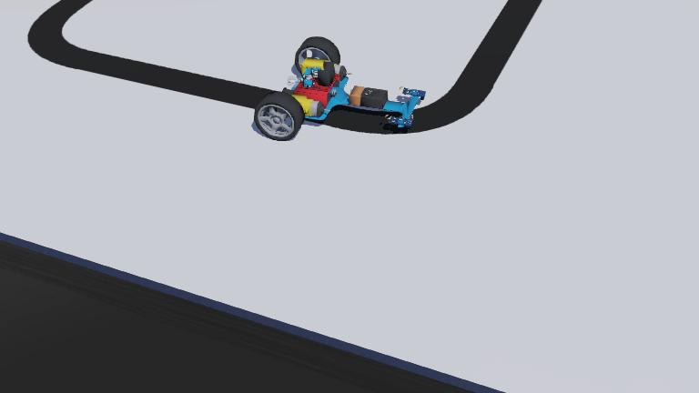

<div align="center">

# 🤖 Robot Line Follower 3D — Tinkercad to Webots

**Transisi Desain 3D Chassis & Perakitan Elektronik (Tinkercad) ke Simulasi Fisika Otonom (Webots)**  
*Mata Kuliah Praktikum Internet of Things (IoT) — Bab 7*


<br>



</div>

---

## ✨ Fitur Utama

- **Model 3D Presisi dari Tinkercad:** Chassis huruf `'T'`, Arduino Uno R3, Driver Motor L298N, Baterai 9V, 2 Motor DC + Roda, dan 2 Sensor IR TCRT5000 (`models/tinker.obj`).
- **Roda Berputar Independen:** Mesh roda kiri & kanan dipisahkan (`wheel_1.obj`, `wheel_2.obj`) dan dipasang ke `HingeJoint` + `RotationalMotor` sehingga berputar nyata mengikuti kecepatan motor.
- **Lintasan Kontras Tinggi:** Arena 2×2 meter dengan jalur hitam pekat di atas lantai putih (`worlds/textures/track.png`), mencakup 1 lintasan lurus panjang dan tikungan melengkung (*rounded*).
- **Kontroler PD Halus:** Algoritma *Proportional-Derivative* (`controllers/line_follower_ctrl/line_follower_ctrl.py`) dengan pembacaan 2 `DistanceSensor` (`infra-red`) pada `THRESHOLD = 880.0`.

---

## 🗺️ Desain Lintasan & Arsitektur Kontrol

| Preview Lintasan (`2m × 2m`) | Alur Logika PD Controller |
| :---: | :---: |
|  | `ir_left` & `ir_right` membaca pantulan lantai (`1000` = putih, `~758` = hitam) → hitung `error = val_left - val_right` → koreksi kecepatan `left_motor` & `right_motor` secara proporsional (`KP=0.015`, `KD=0.011`). |

---

## 📁 Struktur Repositori

```text
├── assets/
│   └── simulasi-webots.jpg              # Screenshot pratinjau simulasi Webots
├── controllers/
│   └── line_follower_ctrl/
│       └── line_follower_ctrl.py        # Source code Python PD Controller
├── models/
│   ├── tinker.obj                       # Model 3D utuh hasil ekspor Tinkercad
│   └── obj.mtl                          # Material & warna model Tinkercad
└── worlds/
    ├── line_follower_world_v2.wbt       # World Webots utama (siap dijalankan)
    ├── models/                          # Mesh terpisah (chassis, wheel_1, wheel_2)
    └── textures/
        └── track.png                    # Tekstur lintasan garis hitam
```

---

## ⚙️ Spesifikasi Robot di Webots

| Komponen | Node Webots | Parameter Utama |
| :--- | :--- | :--- |
| **Penggerak Kiri & Kanan** | `HingeJoint` + `RotationalMotor` | `left_motor`, `right_motor` (`radius = 0.0315 m`) |
| **Sensor Garis** | `DistanceSensor` (`infra-red`) | `ir_left`, `ir_right` (`Y = ±0.032 m`, menghadap `-Z`) |
| **Penopang Depan** | `Solid` (`Sphere`) | `front_caster` (`coulombFriction = 0.02`) |
| **Kecepatan Dasar** | Python Controller | `BASE_SPEED = 4.5`, `MAX_SPEED = 6.8` |

---

## 🚀 Cara Menjalankan Simulasi

1. Clone repositori ini:
   ```bash
   git clone https://github.com/Arthaaaaa/Desain-3D-Chassis-dan-Perakitan-Robot-Line-Follower.git
   ```
2. Buka aplikasi **Webots** (`R2025b` atau kompatibel).
3. Pilih **File** > **Open World...** dan buka `worlds/line_follower_world_v2.wbt`.
4. Klik tombol **Play** (`▶`) di toolbar atas untuk menjalankan robot mengikuti lintasan.
